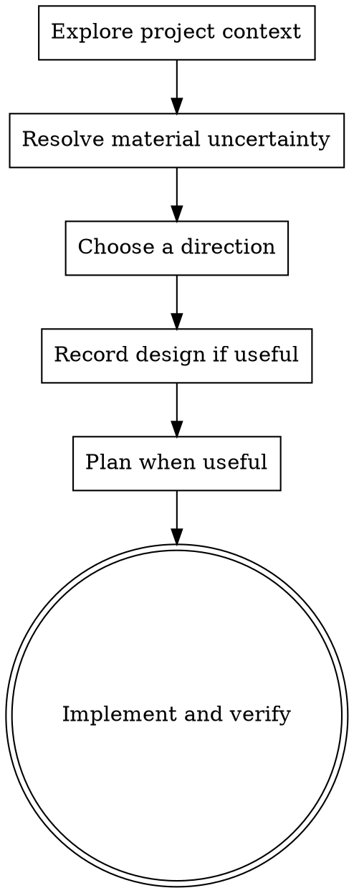

# Brainstorming Ideas Into Designs

Use the lightest design pass that resolves important uncertainty. Understand the
request and current project, make routine choices independently, then continue
to implementation when the direction is clear. Ask only when missing information
would materially change the result or cross a real permission boundary.

## Token budget (gipypowers)

Context window is 272k–400k tokens. Never let this session's working-context, or any subagent prompt you construct, exceed ~27k tokens (10% of the 272k floor). Delegate to isolated subagents, persist bulk output (plans, diffs, reviews) to files, and keep only pointers in context.

## Anti-Pattern: Overdesigning Clear Work

For a small, clear change, make a brief internal plan and implement it. Use a
written design when the task spans meaningful components, has consequential
trade-offs, or needs durable architectural decisions.

## Checklist

1. **Explore project context** — inspect relevant files and decisions.
2. **Resolve material uncertainty** — infer routine choices; ask only if an
   answer would change the result or is required to proceed safely.
3. **Choose a direction** — compare approaches when a meaningful trade-off
   exists; otherwise use the simplest approach that satisfies the request.
4. **Record durable design** — write a concise spec when the task spans
   components or includes a decision worth reusing.
5. **Continue execution** — plan when useful, then implement and verify inline.

## Process Flow

**The goal is completed work.** Design supports implementation; it does not replace it.

## The Process

**Understanding the idea:**

- Before asking detailed questions, assess scope: if the request describes multiple independent subsystems (e.g., "build a platform with chat, file storage, billing, and analytics"), flag this immediately — don't spend questions refining details of a project that needs to be decomposed first.
- For large projects, identify independent components and sequence them into one
  executable plan. Continue with the first useful implementation step.
- Ask one focused question only when a material unknown cannot be inferred from
  the request or repository. Otherwise state the assumption and proceed.

**Exploring approaches:** propose 2-3 different approaches with trade-offs, presented conversationally; lead with your recommended option and explain why.

**Presenting the design:**

- Scale explanation to complexity: a few sentences for straightforward work,
  more detail only for consequential trade-offs.
- State the chosen direction and continue unless the user requested a review
  checkpoint or a genuine blocker requires input.
- Cover: architecture, components, data flow, error handling, testing
- Be ready to go back and clarify if something doesn't make sense

**Design for isolation and clarity:**

- Break the system into smaller units that each have one clear purpose, communicate through well-defined interfaces, and can be understood and tested independently
- For each unit, you should be able to answer: what does it do, how do you use it, and what does it depend on?
- Can someone understand what a unit does without reading its internals? Can you change the internals without breaking consumers? If not, the boundaries need work.
- Smaller, well-bounded units are also easier for you to work with — you reason better about code you can hold in context at once, and your edits are more reliable when files are focused. When a file grows large, that's often a signal that it's doing too much.

**Working in existing codebases:**

- Explore the current structure before proposing changes. Follow existing patterns.
- Where existing code has problems that affect the work (a file that's grown too large, unclear boundaries, tangled responsibilities), include targeted improvements as part of the design — the way a good developer improves code they're working in.
- Don't propose unrelated refactoring. Stay focused on what serves the current goal.

## After the Design

**Documentation:**

- Write the validated design (spec) to `docs/superpowers/specs/YYYY-MM-DD-<topic>-design.md`
  - (User preferences for spec location override this default)
- Use elements-of-style:writing-clearly-and-concisely skill if available
- Keep design and implementation changes in the task's final commit.

**Spec Self-Review:**
After writing the spec document, look at it with fresh eyes:

1. **Placeholder scan:** Any "TBD", "TODO", incomplete sections, or vague requirements? Fix them.
2. **Internal consistency:** Do any sections contradict each other? Does the architecture match the feature descriptions?
3. **Scope check:** Is this focused enough for a single implementation plan, or does it need decomposition?
4. **Ambiguity check:** Could any requirement be interpreted two different ways? If so, pick one and make it explicit.

Fix any issues inline. No need to re-review — just fix and move on.

**Implementation:**

- Create a plan when multi-step work benefits from explicit sequencing, then
  execute it inline. Load implementation guidance only where it applies.

## Key Principles

- **One question at a time** - Don't overwhelm with multiple questions
- **Multiple choice preferred** - Easier to answer than open-ended when possible
- **YAGNI ruthlessly** - Remove unnecessary features from all designs
- **Explore alternatives** - Compare options when meaningful trade-offs could change the result; otherwise choose the clear default.
- **Incremental validation** - Check the design against the repository and requested outcome
- **Be flexible** - Go back and clarify when something doesn't make sense

## Visual Companion

Use the browser companion and `skills/brainstorming/visual-companion.md` when a
real mockup or visual comparison would materially improve the result. Keep text
decisions in the normal workflow. Do not pause clear implementation to offer an
optional presentation mode.
